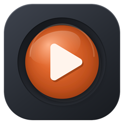

<p align="center"></p>

# MiniFlix

**Seu catálogo de vídeos offline, no pendrive.** O MiniFlix é um "mini streaming" para Windows que roda direto de qualquer pasta ou pendrive. Você baixa ou importa vídeos uma vez e depois assiste sem internet, em qualquer PC, sem instalar nada e sem deixar rastros no computador.

> 🚧 **Status: quase lá.** Catálogo, player completo, administração, importação de arquivos e download do YouTube já funcionam. Falta o empacotamento final para pendrive. Veja o [roadmap](#roadmap).

---

## Para que serve

- **Aulas e cursos** para assistir onde não há internet (sala de aula, viagem, zona rural).
- **Acervo pessoal** de vídeos organizado por categorias, com capa, descrição e busca.
- **Levar o acervo no bolso:** pluga o pendrive, abre o `MiniFlix.exe` e assiste. Ao tirar o pendrive, nada fica no PC.

## Funcionalidades planejadas

- 📚 **Catálogo** com capas, busca em tempo real (título, descrição, tags e categoria) e vídeos agrupados por categoria (seções recolhíveis, lembradas entre sessões).
- ▶️ **Player** completo: velocidade de reprodução, tela cheia e atalhos de teclado no estilo do YouTube (`Espaço`, `J`/`L`, setas, `F`, `M`, `0`–`9`).
- ⏯️ **Continuar assistindo:** o MiniFlix lembra onde você parou em cada vídeo.
- ⬇️ **Adicionar do YouTube** colando a URL. A fila baixa um vídeo por vez e mostra o progresso em tempo real.
- 📁 **Importar vídeos do computador**, convertendo para MP4 só quando necessário.
- 🗂️ **Gerenciar o acervo:** editar título, categoria, tags e descrição, ou excluir vídeos.
- ✏️ **Renomear categoria:** muda todos os vídeos dela de uma vez (ou une com uma categoria existente).
- ⭐ **Favoritos:** estrela no player e na administração; os favoritos ganham uma fileira própria no catálogo.
- 🔎 **Filtros do acervo:** texto, categoria, tags, “Sem tags” e “Só favoritos”, combináveis.
- 🏷️ **Tags:** cada vídeo pode ter várias tags; o catálogo filtra por uma ou mais delas (o vídeo precisa ter todas). Na administração, dá para selecionar vários vídeos e adicionar/remover tags de uma vez; a importação também aceita tags.
- 📁 **Pasta dos vídeos configurável:** o acervo pode ficar em qualquer pasta (outro disco, HD externo); a escolha é salva em `data\settings.json`.
- 🌗 **Modo claro e modo escuro.**
- 🔌 **100% offline e portátil:** nenhuma CDN, nada no Registro, nada em `AppData`.

## Como funciona

```
MiniFlix.exe  (C# / .NET 10, WinForms)
   └── WebView2 ── interface HTML + CSS + JavaScript puro
         │           servida em https://app.miniflix.example/ (pasta do app)
         │           vídeos em https://videos.miniflix.example/ (pasta dos vídeos)
         └── ponte JS ↔ C#  ──►  yt-dlp · ffmpeg · arquivos JSON
```

- A interface é uma página web local exibida pelo **WebView2** (o motor do Microsoft Edge), sem servidor e sem internet.
- Os vídeos são MP4 (H.264 + AAC) tocados pela tag `<video>`, com seek instantâneo mesmo em arquivos grandes.
- Cada vídeo fica na própria pasta, com `.mp4`, capa `.jpg` e metadados `.json`. Dá para fazer backup copiando pastas.
- O WebView2 pode ir **dentro da pasta do app** (*Fixed Version Runtime*), para funcionar mesmo em PCs que não o têm instalado.

### Estrutura da pasta portátil

```text
MiniFlix\
  ├── MiniFlix.exe
  ├── bin\       yt-dlp, ffmpeg, deno, webview2
  ├── ui\        interface (HTML/CSS/JS)
  ├── data\      configurações, progresso, cache
  └── videos\    acervo (padrão; pode apontar para outra pasta)
        └── aula-01-introducao\
              ├── aula-01-introducao.mp4
              ├── aula-01-introducao.jpg
              └── aula-01-introducao.json
```

## Compilando

**Requisitos:** Windows 10/11 x64 e [.NET 10 SDK](https://dotnet.microsoft.com/download).

```powershell
git clone https://github.com/sbrascher/miniflix.git
cd miniflix
.\tools\baixar-tailwind.ps1  # opcional: Tailwind CLI standalone (só para alterar o CSS)
.\build.ps1                  # gera dist\MiniFlix (portátil, self-contained)
.\build.ps1 -AcervoTeste     # idem + 13 vídeos de exemplo com capa e metadados (requer ffmpeg no PATH)
.\build.ps1 -VideoTeste      # idem + um vídeo de ~1,2 GB para testar seek
dotnet test MiniFlix.slnx    # testes unitários
.\build.ps1 -Pacote          # ZIPs para distribuição em dist\pacotes (completo e leve) + SHA256SUMS.txt
.\tools\gerar-icone.ps1      # regenera miniflix.ico (16–256 px) a partir de assets\icone\*.svg
```

### Distribuição

O `-Pacote` monta, a partir de uma publicação limpa (sem vídeos, logs nem dados pessoais), dois ZIPs:

| Pacote | Tamanho | Para quem |
|---|---|---|
| `MiniFlix-<versão>-win-x64.zip` | ~450 MB | Qualquer Windows 10/11 x64 (inclui o WebView2) |
| `MiniFlix-<versão>-win-x64-leve.zip` | ~190 MB | Windows 11, ou Windows 10 com o WebView2 instalado |

Antes de compactar, o script confere se todas as dependências estão presentes. Depois de compactar, verifica a estrutura de cada ZIP e se não há dados pessoais dentro. O ideal é publicá-los numa *Release* do GitHub.

O CSS compilado (`src\ui\css\app.css`) é versionado, então o Tailwind só é necessário para alterar estilos. Não é preciso Node.

Para gerar uma versão totalmente portátil, os binários de terceiros ficam em `vendor\bin\`. A pasta não é versionada; o `build.ps1` a copia para `dist\MiniFlix\bin\`. O script abaixo baixa o yt-dlp, o Deno e o ffmpeg (cerca de 310 MB):

```powershell
.\tools\baixar-dependencias.ps1 -WebView2   # yt-dlp, Deno, ffmpeg, licenças e WebView2 Fixed Runtime
.\tools\baixar-dependencias.ps1 -SoWebView2 # só (re)baixa o WebView2
```

O WebView2 Fixed Runtime não tem link estável. O script lê a página oficial com o Edge em modo headless, baixa o `.cab` x64 mais recente do domínio de downloads da Microsoft, **confere a assinatura digital da Microsoft** e o extrai em `vendor\bin\webview2`, mantendo só os idiomas pt-BR e en-US (cerca de 546 MB). Para manter todos os idiomas, use `-ManterTodosIdiomas`.

| Arquivo | Onde obter |
|---|---|
| `webview2\` | [WebView2 Fixed Version Runtime](https://developer.microsoft.com/microsoft-edge/webview2/) (x64, baixado pelo script com `-WebView2`) |
| `yt-dlp.exe` | [github.com/yt-dlp/yt-dlp](https://github.com/yt-dlp/yt-dlp/releases) |
| `ffmpeg.exe`, `ffprobe.exe` + DLLs | [BtbN/FFmpeg-Builds](https://github.com/BtbN/FFmpeg-Builds/releases) (build *gpl-shared*) |
| `deno.exe` | [deno.com](https://deno.com/) (runtime JS exigido pelo yt-dlp para o YouTube) |

Sem `vendor\bin\webview2`, o app usa o WebView2 instalado no Windows.

As licenças dos componentes de terceiros vão para `bin\licencas`; o FFmpeg é GPL, então o texto da licença precisa acompanhar os binários. O manual do usuário final (`README.txt` da pasta portátil) é gerado pelo `build.ps1` a partir de [`pacote/README.txt`](pacote/README.txt), com a versão e a data preenchidas.

### Modos de diagnóstico

```powershell
.\dist\MiniFlix\MiniFlix.exe --autoteste
.\dist\MiniFlix\MiniFlix.exe --captura "#/video/aula-01-introducao" tela.png
```

- `--autoteste` verifica a ponte JS ↔ C#, as requisições HTTP Range, o seek em vários pontos do vídeo e a liberação do arquivo após descarregar o player. O relatório fica em `data\logs\autoteste.json`.
- `--captura` abre uma tela e salva um PNG. É útil para conferir o visual sem clicar.
- O log do app fica em `data\logs\miniflix.log`.

## Roadmap

- [x] **1. Protótipo técnico:** WebView2 portátil, host virtual, seek em vídeo de mais de 1 GB, liberação de arquivo.
- [x] **2. Catálogo:** leitura de `/videos`, cache, busca, filtro por categoria, tema claro/escuro e player básico.
- [x] **3. Player:** atalhos de teclado no estilo do YouTube (tecla `?` mostra a lista), "continuar assistindo" com retomada automática, selo de assistido, tela cheia e volume lembrado.
- [x] **4. Importação de vídeos locais:** vários arquivos de uma vez, cópia sem reconversão quando possível, capa automática, fila com progresso e cancelamento.
- [x] **5. Download do YouTube:** até 1080p, H.264/AAC, capa e descrição do vídeo, mensagens de erro claras e botão para atualizar o yt-dlp.
- [x] **6. Gerenciamento do acervo:** listagem com filtro, editar título/categoria/descrição e excluir com confirmação.
- [x] **7. Visual "Soft UI":** relevo tátil nos temas claro (off-white) e escuro (grafite), com destaque laranja. Contraste WCAG AA, suporte a Alto Contraste do Windows e a "reduzir movimento". Tokens e componentes em `src/ui/css/input.css`.
- [ ] 8. Empacotamento final e teste em PC limpo, a partir do pendrive.

O plano completo está em [`plano.md`](plano.md).

## Dicas para o pendrive

- Prefira formatar em **exFAT** ou **NTFS**. O **FAT32** não aceita arquivos acima de 4 GB.
- Feche o MiniFlix antes de remover o pendrive.

## Uso responsável

O MiniFlix usa o [yt-dlp](https://github.com/yt-dlp/yt-dlp) para baixar vídeos. Baixe apenas conteúdo **seu, licenciado ou com permissão do autor**, respeitando os termos de uso das plataformas e os direitos autorais. O projeto não tem vínculo com o YouTube nem com nenhum serviço de streaming.
